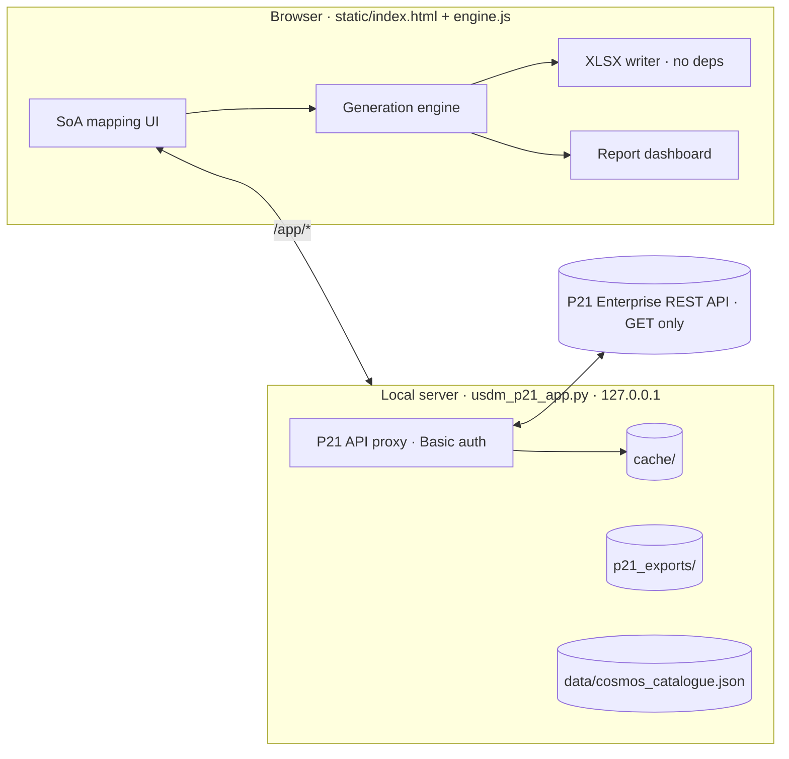

# USDM → P21 Workbench (POC)

> Turn a CDISC **USDM v4** protocol into **Pinnacle 21 Enterprise** study artefacts — SDTM define spec, CRF form spec and Trial Summary — by linking each Biomedical Concept to **CDISC COSMoS** specializations and persisting those choices back into the USDM.

    

---

## Contents
- [What it does](#what-it-does)
- [Quick start](#quick-start)
- [Workflow](#workflow)
- [Architecture](#architecture)
- [Repository layout](#repository-layout)
- [Generation rules](#generation-rules)
- [USDM extensions](#usdm-extensions)
- [P21 API usage](#p21-api-usage)
- [Command-line pipeline](#command-line-pipeline)
- [Limitations](#limitations)
- [Roadmap](#roadmap)

## What it does

| Input | Process | Output |
|---|---|---|
| USDM v4 JSON (with or without extensions) | Match each BC to a COSMoS **SDTM dataset specialization** and **CRF specialization** using BC code + SoA activity context; user confirms | **Extended USDM** (selections persisted as extensions + hidden P21 internalId links) |
| P21 master standard + terminology (API or local export) | Subset by the selected specializations (domain shell, VLM, 3-rule codelist cut) | **SDTM define spec** (.xlsx / P21-shaped .json) |
| COSMoS CRF specializations and/or a P21 **form library** | Library form per activity where it fits, COSMoS items as fallback, cross-match reconciliation | **CRF form spec** (events, forms, SoA, questions, codelists) |
| USDM design (arms, epochs, encounters, criteria, interventions) | DDF-RA style mappings | **TS** (+ TA, TE, TV, TI) |
| All of the above | Coverage analysis | **Report dashboard** + JSON report |

## Quick start

```bash
cd app
python usdm_p21_app.py            # opens http://127.0.0.1:8765
# Windows: double-click run_workbench.bat
# macOS/Linux: ./run_workbench.sh   (first time: chmod +x run_workbench.sh)
```

- **Online:** step 2 → enter your P21E root URL (e.g. `https://my-company.pinnacle21.com`) and a *User API Key* (P21E › Your Profile › API Key › Add Key). Or set `P21_API_KEY` and pass `--base-url`.
- **Offline:** leave the key blank – the app uses JSON exports you place in `app/p21_exports/` (git-ignored; e.g. SDTMIG 3.4 + SDTM CT 2026-03-27 exported from P21E).
- **Sample study:** step 1 → *load sample CTX101-001 (no extensions)*.

No install required – standard-library Python only. A zero-server, single-file demo is also available: open `USDM_P21_Workbench_Demo.html` in a browser (embedded data, no API, no form library).

## Workflow

```
1 Load USDM ─► 2 Standard & terminology ─► 3 Map specializations ─► 4 Generate & export ─► 5 Report dashboard
                 (P21 API lists / exports)    (SoA view + table view)    (xlsx / json)           (KPIs, charts, findings)
```

**Step 3 – mapping in the SoA.** The main timeline is followed by a grid per sub-timeline (e.g. Day 1 intensive PK sampling). Each activity row expands to its BCs with inline SDTM / CRF specialization selects aligned to the visit columns. Suggestions are ranked by BC code, name and *activity context* (e.g. *Glucose* under *Urinalysis* → `GLUCURINPRES`, under *Chemistry* → `GLUCSERPL`). A side drawer shows candidate scores, specialization variables and a preview of CRF item reconciliation. A table view gives the same selections for bulk review. When a form library is loaded, each activity also gets a **form source** (library form vs COSMoS direct).

## Architecture



The API key never reaches the browser; the server binds to `127.0.0.1` only.

## Repository layout

```
USDM_P21/
├── app/                              # Local workbench (recommended)
│   ├── usdm_p21_app.py               #   stdlib HTTP server + P21 API proxy + master builder
│   ├── run_workbench.bat             #   Windows launcher
│   ├── run_workbench.sh              #   macOS / Linux launcher
│   ├── static/index.html             #   UI (5 steps + dashboard)
│   ├── static/engine.js              #   matching, generation, reconciliation, XLSX writer
│   ├── data/cosmos_catalogue.json    #   local COSMoS specialization table (98 SDTM / 309 CRF)
│   ├── data/sample_usdm_no_extensions.json
│   ├── p21_exports/                  #   offline standard / terminology / form exports
│   └── cache/                        #   API export cache (24 h)
├── USDM_P21_Workbench_Demo.html      # Single-file demo (no server)
├── demo/                             # Demo sources (template, engine, sample USDM)
├── scripts/                          # Python batch pipeline (00–05)
├── reference/                        # COSMoS tables: cosmos_sdtm_item.csv, cosmos_crf_item.csv, headers
├── CTX101-001_USDM_v4.json           # Sample Phase 1 SAD USDM with specialization extensions
├── p21/                              # Batch outputs for CTX101-001 (define, CRF, TDM, report, xlsx)
├── POC_SUMMARY.md
└── README.md
```

## Generation rules

**SDTM define**
1. Domains = domains of the selected SDTM specializations + TA/TE/TV/TI/TS.
2. Variables = all *Required/Expected* variables of each domain (domain shell) ∪ specialization variables (`mandatory_variable = Y` by default).
3. VLM rows for `vlm_target = Y` variables; where-clause from `EQ` comparators with assigned values (e.g. `LBTESTCD EQ "HGB" AND LBSPEC EQ "BLOOD"`).
4. Codelist cut, per codelist:

| Situation | Result |
|---|---|
| Assigned value / value list from specializations (or USDM for EC dose unit, route, form, frequency; generated values for trial design) | Subset to those terms (extensible → sponsor terms added and reported) |
| A selected specialization references the codelist with no constraint | Full codelist |
| Non-extensible (closed) codelist | Full codelist |
| Used only by shell variables that are **not** Record Qualifiers (e.g. `LBNRIND`) | Full codelist |
| Extensible, used only by shell **Record Qualifier** variables (e.g. `MBMETHOD`, `ARMNRS`) | Deferred – empty, flagged *to be populated* |

**Ordering** – datasets by SDTMIG class (Trial Design, Special Purpose, Interventions, Events, Findings, Findings About, Relationship), then alphabetically. Variables follow the master standard's `order`; variables the P21 export leaves unordered (e.g. `STUDYID`, `--SEQ`, `LBORRES` in SDTMIG 3.4) are placed by *location*: fixed anchors STUDYID/DOMAIN/USUBJID, otherwise next to the same variable's neighbour in other domains of the same class (`LBORRES` after `LBBODSYS` because `VSORRES` follows `VSBODSYS`). Orders are renumbered 1..n per dataset (`customAttribute.sourceOrder` / `orderSource` keep the provenance). VLM rows follow dataset → variable order; codelists are alphabetical and terms keep CT order.

**CRF form spec** – per activity: library form (tier 1) → COSMoS CRF specialization written directly (tier 3); BCs not on the library form fall back to COSMoS items. When a user picks a CRF specialization built for a *different* SDTM specialization of the same BC (e.g. `SODIUMBLD` CRF for `SODIUMSERPL`), items are reconciled to the SDTM side (specimen, value lists, data type) and items without a counterpart are flagged for review.

## USDM extensions

SoA-Workbench-compatible specialization links on each `BiomedicalConcept`, plus hidden P21 links (`internalId|natural key`) that let the define be re-resolved after IDs change:

```json
{"url": "http://www.cdisc.org/usdm/extensions/specializations/sdtm",
 "valueString": "/mdr/specializations/sdtm/datasetspecializations/HGBBLD"},
{"url": "http://www.cdisc.org/usdm/extensions/specializations/crf",
 "valueString": "/mdr/specializations/crf/specializations/HGBBLD_DENORMALIZED"},
{"url": "https://www.certara.com/usdm/extensions/p21/sdtm-link", "extensionAttributes": [
   {"url": ".../p21/dataset",       "valueString": "85080|LB"},
   {"url": ".../p21/topicVariable", "valueString": "2564305|LB.LBTESTCD"},
   {"url": ".../p21/topicTerm",     "valueString": "31298725|LBTESTCD|HGB|C64848"},
   {"url": ".../p21/whereClause",   "valueString": "LBTESTCD EQ \"HGB\" AND LBSPEC EQ \"BLOOD\""}]}
```

Study-level: `p21/study-link` (standard specId, terminology specId, timestamp). Activity-level: `p21/form-source` (`lib:<formId>`). Loading an extended USDM restores all selections. Output validates against the CDISC `usdm` 4.0 model and passes all implemented `usdm4` rules (see limitations for DDF00155).

## P21 API usage

Read-only, `Authorization: Basic base64(<key>:<key>)` ([P21 help article](https://help.pinnacle21.certara.net/en/articles/9718617-using-the-p21e-api-to-export-metadata)):

| Purpose | Endpoint |
|---|---|
| List standards / terminologies / library forms | `/api/standards` · `/api/terminologies` · `/api/metadata/forms` |
| Export a spec | `/api/{standards\|terminologies\|forms}/:id/export?format=json[&usePublished=true]` |

Local app endpoints: `GET /app/config|standards|terminologies|forms|test|catalogue|sample`, `POST /app/config|master|formlib`.

## Command-line pipeline

```bash
python scripts/00_build_cosmos_tables.py <cosmos_yaml_dir> reference
python scripts/01_build_usdm.py reference term34.json CTX101-001_USDM_v4.json
python scripts/02_generate_p21.py CTX101-001_USDM_v4.json reference sdtm34.json term34.json p21 [--all-variables] [--no-vlm]
python scripts/03_export_excel.py p21 p21/CTX101-001_P21_Study_Spec.xlsx
python scripts/04_build_demo_data.py reference CTX101-001_USDM_v4.json sdtm34.json term34.json demo
python scripts/05_build_demo_html.py demo USDM_P21_Workbench_Demo.html
```
Scripts 01/04 need `pip install usdm` (CDISC USDM pydantic model) for validation.

## Limitations

- **P21 API is GET-only** – artefacts are downloaded (xlsx/json) for import, not written back.
- **COSMoS catalogue is a POC subset** (98 SDTM / 309 CRF specializations relevant to the sample study); production would read the full table maintained in P21.
- **Form-library matching is heuristic** (test codes in `sdtmTarget` / question IDs) and has only been tested against a mock library export.
- **CT subset:** codelists > 1,000 terms are carried with referenced terms only.
- **USDM rule DDF00155** in `usdm4` has a stale CT-version list (ends 2025-03-28); with current versions appended all implemented rules pass.
- **Sub-timelines** are shown in the mapping step (one purple grid per non-main `ScheduleTimeline`, with its trigger – activity `timelineId` or instance `timelineId` – and timing labels; BC selections are shared with the main grid), but generation uses the **main timeline** only: TV, CRF events and the CRF schedule of activities ignore sub-timeline timepoints. TM/TD are out of scope.
- **Procedure-only activities are not resolved (key gap).** Generation only follows `Activity.biomedicalConceptIds` (plus BC categories). Many real USDMs describe assessments as `Activity.definedProcedures` (a `Procedure` with a code such as CPT/SNOMED/NCIt, e.g. "12-lead ECG", "Complete blood count") with no BCs attached. These activities show no BCs, so no specialization, define content or form items are generated. Support is deferred; see [Roadmap](#roadmap).

## Roadmap

- Validate form-library matching against a real P21 form library export; curated library ↔ specialization link table
- CDASH-template tier (placeholder resolution) between library and COSMoS direct
- Full COSMoS catalogue sync and version-diff on re-generation
- Role/override list for codelist rules (e.g. always-full `RSLSCLRS`)
- Surrogate handling via terminology (e.g. `LEUKASE` test code) and SUPP-- generation
- **Procedure → BC expansion** (not built): a curated reference table `procedure_code → [bc_id, default sdtm/crf specialization]` held in P21 next to the specialization table (e.g. ECG procedure → HR, PR, QRS, QT, QTcF, RR, interpretation; CBC → HGB, HCT, RBC, WBC, PLAT, differential). On load, procedure-only activities would be expanded into *proposed* BCs written back as USDM `BiomedicalConcept`s on the activity, so the existing SoA mapping, generation and extension persistence work unchanged. User confirmation required; unmatched procedure codes reported as gaps.

---
*Proof of concept – not validated for regulatory use. CTX101-001 is a fictional study.*
